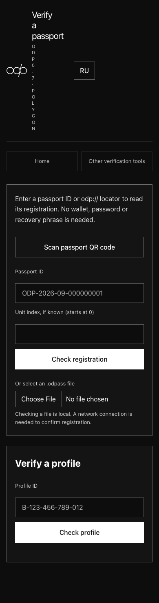

# Проверка сайта по Modern Web Guidance — 15 ноября 2026

Проверена **текущая локальная рабочая копия**, ветка `codex/odp-07-site-20261106`, включая существующие незакоммиченные изменения. Продуктовый код не менялся. Результат не описывает автоматически опубликованную версию.

## Метод и границы

- CLI `modern-web-guidance@latest`: выполнены `list` и `retrieve "accessibility,forms,responsive-design,performance,security,html"`. Использованы рекомендации, полученные 15 ноября 2026. `legacy-scan` не запускался: задача — аудит, а не модернизация.
- Восемь страниц: `index`, `verify-07`, `profile-07`, `issue-07`, `release-07`, `verify`, `creator`, `passport`. Начальные состояния проверены с EN/RU, axe-core 4.14.0, ширинами 320/390/521/768/1440 CSS px — 16 состояний и 80 замеров в Chromium.
- Существующий Playwright-набор Chromium: **27/29 прошли**, два падения мобильной вёрстки. Отдельный набор layout в WebKit: **2/4 прошли**, те же два падения. WebKit здесь — автоматизация движка, не Safari на физическом iPhone.
- Проверены клавиатурный переход к подтверждению профиля и обратно, ошибка формата ID, открытие QR-диалога и Escape. Кошелёк и registry в дополнительной проверке профиля подменены; запрос камеры удерживался незавершённым, настоящая камера не открывалась.
- Внешние запросы в браузерных проверках блокировались. Реальные WalletConnect/Safe/Polygon, успешное сканирование камерой, VoiceOver, полевые CWV и production-заголовки не проверены. Запрос HTTPS-заголовков публичного сайта завершился тайм-аутом через 20 секунд; это не доказывает недоступность сайта для пользователей.

## Подтверждённые проблемы — по приоритету

### 1. P1 — мобильная шапка сжимает заголовок до нулевой ширины

**Где:** `frontend/css/odp.css:2470`, `frontend/css/odp-home.css:120`.

На четырёх страницах 0.7 (`verify`, `profile`, `issue`, `release`) при 320 и 390 px заголовок имеет ширину **0 px**. Текст при этом может рисоваться за границами своего блока: слова и подзаголовок ломаются в узкую вертикальную колонку. Это воспроизводится в Chromium и WebKit. Отсутствие горизонтального переполнения не означает исправную вёрстку.

Причина: общий адаптивный стиль задаёт `.header-toolbar { width:100% }`, а новый стиль при ширине до 520 px переводит родительскую шапку в горизонтальный flex. Панель языка занимает всю строку и сжимает `.header-left`.

Контрольный эксперимент только в DOM браузера: при 390 px панель занимала все **358 px** контейнера; после локального переопределения её `width:auto; flex-shrink:0` заголовок профиля получил **232 px**. Исходный CSS не изменялся.

**Рекомендация:** согласовать размеры обоих flex-элементов в мобильной шапке и проверить длинные русские заголовки, а не ограничиваться проверкой `scrollWidth`.

### 2. P2 — кнопка языка не содержит видимый текст в доступном имени

**Где:** `frontend/js/odp-v07-profile-ui.js:24`; аналогично UI проверки, выпуска и действий.

На экране кнопка показывает `RU` или `EN`, а `aria-label` заменяет это на `Change language to Russian` / `Switch language to English`. Axe сообщает `label-content-name-mismatch` с уровнем serious на всех четырёх рабочих страницах в обоих языках. Голосовое управление по видимой надписи становится менее надёжным.

**Рекомендация:** включить видимый код языка в доступное имя, например `RU — Change language to Russian`; согласовать текст и язык подписи. Это правило WCAG 2.5.3 Label in Name, а не требование заменить обычную кнопку новым API.

### 3. P2 — ошибка ID не связана с полем и не направляет к нему фокус

**Где:** `frontend/js/odp-v07-verify.js:48`, `frontend/js/odp-v07-verify.js:221`.

После отправки `wrong` видна корректная текстовая ошибка в `aria-live`, однако `#passport-id` остаётся `validity.valid === true`, отсутствуют `aria-invalid` и `aria-describedby`, фокус остаётся на кнопке отправки. Проверка профиля аналогично выводит ошибку формата без связи с полем.

**Рекомендация:** при custom validation устанавливать состояние ошибки, связывать её текст с конкретным полем и переводить фокус к первому неверному полю либо к сводке. При исправлении сбрасывать состояние. Существующий live region сохранить; его наличие уже помогает сообщить ошибку.

### 4. P2 — переходы подтверждения профиля не управляют фокусом

**Где:** `frontend/js/odp-v07-profile-ui.js:29` и `:31`.

При клавиатурном нажатии Review появляется `#confirmation`, но фокус остаётся на `#review`. При нажатии Back секция скрывается, а непосредственно после обработчика `document.activeElement` ещё указывает на скрытую кнопку `#back`. Нет явного возврата к началу шага.

**Рекомендация:** после открытия переводить фокус на заголовок подтверждения с `tabindex="-1"` либо первое осмысленное поле; после Back возвращать его к Review. Это обычная встроенная секция, превращать её в модальный диалог не требуется.

### 5. P2 — низкий контраст ссылок перехода к версии 0.7 на старых страницах

**Где:** `frontend/verify.html:65`; аналогичные ссылки в `creator.html` и `passport.html`.

В начальной синей теме axe измерил контраст ссылки **1.16:1**: текст `#0000ee` на фоне `#2b4c9b` при 13 px вместо требуемых 4.5:1 для обычного текста. На старой странице проверки подпись `Processed locally — not uploaded` имеет контраст **2.94:1**.

**Рекомендация:** задать цвет ссылок, читаемый в каждой теме; убрать снижающую контраст прозрачность подписи либо подобрать подходящий цвет. Проверить также посещённые ссылки.

## Дополнительные наблюдения

| Область | Наблюдение и следующий шаг |
| --- | --- |
| Семантика старых страниц | Axe нашёл `region` и `heading-order`: навигация сделана как `div.nav`, основное содержимое не охвачено `main`; заголовок панели доверия — `h3` без предшествующего `h2`. Исправлять с учётом структуры и поведения самой панели. Это дополнительные замечания, не отдельные высокоприоритетные сбои. |
| Масштаб текста | При изменении корневого размера шрифта до 200% заголовок главной остаётся 28 px, заголовки рабочих страниц — 22 px: размеры заданы в px. Это подтверждённое отсутствие реакции этих заголовков на корневой масштаб. **Не является полноценным тестом браузерного zoom или доказательством нарушения WCAG 1.4.4**. Стоит перейти к rem-компонентам в типографике и проверить реальный zoom отдельно. |
| Локализация | После переключения страницы проверки на RU `html.lang` и видимый заголовок меняются, но `document.title` остаётся `ODP 0.7 — Verify`. Локализовать заголовки вкладок вместе с содержимым. |
| Стабильность изображения | Логотип 6 373 байта — небольшой; современный формат сам по себе не приоритет. Но у `img.home-logo` отсутствуют HTML dimensions/aspect-ratio, в CSS задана ширина и `height:auto`. До загрузки нет явного резервирования высоты. Задать пропорции; реальное значение CLS не измерялось. |
| Загрузка и защита | Рабочие страницы 0.7 используют `defer`; QR-декодер и кошельковые bundle загружаются по запросу. На старой `verify.html` ethers, jsQR и JSZip синхронны в head. В проверенных HTML/Pages workflow не обнаружена настройка CSP; production-заголовки неизвестны. Дальнейшее усиление CSP требует проверки WalletConnect, камеры и разрешённых Safe embed origins — запрет всех iframe сломает Safe App. |

## Что прошло

- В 80 замерах начальных состояний не обнаружено горизонтального переполнения. Старое наблюдение переполнения при 521 px **сейчас не воспроизводится**. Развёрнутые формы во всех ширинах этим утверждением не охвачены.
- Все **84** локальные ссылки и ресурса в пяти основных HTML разрешаются в подготовленной копии сайта. В дополнительных загрузках восьми страниц не было необработанных JS-исключений.
- На главной axe не нашёл нарушений в EN/RU в проверенном начальном состоянии. На четырёх рабочих страницах axe выявил только описанное несовпадение имени кнопки языка; ручные проверки нашли проблемы, которые axe не заметил.
- QR использует нативный `dialog.showModal()`: при открытии фокус на Close camera, Escape закрывает диалог и возвращает фокус на Scan. Это проверка диалога, не качества распознавания QR.
- В просмотренном коде 0.7 результаты и текстовые превью добавляются через `textContent` / DOM API. Существующий сценарий цифрового оригинала проверяет, что строка с `` остаётся текстом. Закреплённые внешние scripts имеют SRI и `crossorigin`. Это положительные признаки, **не полный аудит безопасности**.

## Доказательства и повторение

- [Результаты axe и 80 замеров](results.json)
- [Точечные проверки](probe.json)
- [Скрипт аудита](audit.cjs), [скрипт воспроизведения](probe.cjs)
- [Мобильная главная](index-390.png)

Скрипты запускались из корня репозитория, использовали установленный Playwright из `frontend/e2e/node_modules`, axe из `/tmp/odp-mwg-audit/axe/package/axe.min.js` и временную статическую копию сайта на `127.0.0.1:4185`. Для повторения нужно подготовить эти зависимости и копию: frontend как web root, backend/js и backend/config внутри web root/backend. Внешние запросы намеренно блокируются.

Рекомендуемый порядок исправлений: мобильная шапка → кнопка языка → ошибки полей и фокус → контраст старых страниц. Изменений продукта и публикации в рамках этой проверки не было.

### Modern Web Guidance

Я сверил сайт с `accessibility`, `forms`, `responsive-design`, `performance`, `security` и `html`. Руководства использованы для оценки и рекомендаций; код сайта не изменялся, поэтому применённых изменений API/CSS нет.
